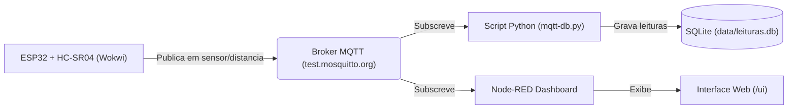

# Monitoramento de Sensor de Distância via MQTT, Node-RED e SQLite

Projeto de Internet das Coisas (IoT) para monitoramento em tempo real de medições de distância utilizando simulação no **Wokwi** (ESP32 + HC-SR04), transmissão de dados via **MQTT**, persistência em banco de dados **SQLite** e visualização analítica através de um **Dashboard no Node-RED**.

---

## Sumário

- [Visão Geral](#visão-geral)
- [Arquitetura do Sistema](#arquitetura-do-sistema)
- [Estrutura do Repositório](#estrutura-do-repositório)
- [Tecnologias Utilizadas](#tecnologias-utilizadas)
- [Configuração e Execução](#configuração-e-execução)
  - [1. Simulação do Sensor no Wokwi (ESP32)](#1-simulação-do-sensor-no-wokwi-esp32)
  - [2. Coleta e Armazenamento dos Dados (Python + SQLite)](#2-coleta-e-armazenamento-dos-dados-python--sqlite)
  - [3. Dashboard de Visualização (Node-RED)](#3-dashboard-de-visualização-node-red)
- [Tópicos MQTT e Formato de Dados](#tópicos-mqtt-e-formato-de-dados)
- [Estrutura do Banco de Dados](#estrutura-do-banco-de-dados)
- [Atenção: Configuração dos Brokers MQTT](#atenção-configuração-dos-brokers-mqtt)

---

## Visão Geral

O sistema simula um microcontrolador **ESP32** acoplado a um sensor ultrassônico **HC-SR04** na plataforma Wokwi. As medições periódicas são publicadas em um broker MQTT público. 

A partir do broker:
1. **Node-RED**: Subscreve o tópico de medições e plota em tempo real:
   - Manômetro analógico (Gauge) com a distância instantânea (0 a 400 cm);
   - Gráfico temporal com faixas de incerteza da medição ($\pm 0.5\text{ cm}$);
   - Gráfico temporal com média móvel (janela de 50 amostras) e intervalo de confiança a 95% ($\text{IC } 95\%$).
2. **Script Python**: Subscreve o tópico MQTT e persiste cada leitura juntamente com data/hora local em uma base de dados relacional SQLite (`data/leituras.db`).

---

## Arquitetura do Sistema



---

## Estrutura do Repositório

| Arquivo | Descrição |
| :--- | :--- |
| [codigo-sensor.c](file:///home/lucas/Documents/repos/sensor-mqtt/codigo-sensor.c) | Firmware em C/C++ para o ESP32 que lê o sensor ultrassônico e publica no broker MQTT. |
| [mqtt-db.py](file:///home/lucas/Documents/repos/sensor-mqtt/mqtt-db.py) | Script Python responsável por conectar ao broker MQTT e gravar as medições no SQLite. |
| [dashboard-node-red.json](file:///home/lucas/Documents/repos/sensor-mqtt/dashboard-node-red.json) | Fluxo exportado do Node-RED com os nós de processamento e dashboard gráfico. |
| [link-simulação.txt](file:///home/lucas/Documents/repos/sensor-mqtt/link-simulação.txt) | Link direto para execução da simulação do circuito no Wokwi. |
| [README.md](file:///home/lucas/Documents/repos/sensor-mqtt/README.md) | Documentação completa do projeto. |

---

## Tecnologias Utilizadas

- **Microcontrolador & Simulação**: ESP32, Sensor Ultrassônico HC-SR04, [Wokwi Simulator](https://wokwi.com/).
- **Protocolo de Comunicação**: MQTT (Message Queuing Telemetry Transport).
- **Backend / Persistência**: Python 3.9+, SQLite3, biblioteca [`paho-mqtt`](https://pypi.org/project/paho-mqtt/).
- **Dashboard & Análise**: Node-RED com a biblioteca `node-red-dashboard`.

---

## Configuração e Execução

### 1. Simulação do Sensor no Wokwi (ESP32)

1. Acesse o projeto no Wokwi pelo link contido em [link-simulação.txt](file:///home/lucas/Documents/repos/sensor-mqtt/link-simulação.txt):
   - [Simulação no Wokwi](https://wokwi.com/projects/433923339572357121)
2. Caso deseje criar ou alterar o projeto manualmente, copie o conteúdo de [codigo-sensor.c](file:///home/lucas/Documents/repos/sensor-mqtt/codigo-sensor.c) para a aba de código (`sketch.ino`) no Wokwi.
3. Conexões de hardware utilizadas:
   - **Trig Pin**: GPIO `5`
   - **Echo Pin**: GPIO `18`
   - **VCC**: 5V / 3.3V
   - **GND**: GND
4. Clique no botão **Start Simulation** (Play) no Wokwi. O ESP32 conectará na rede `Wokwi-GUEST` e passará a publicar as distâncias medidas no broker a cada 1 segundo.

### 2. Coleta e Armazenamento dos Dados (Python + SQLite)

O script [mqtt-db.py](file:///home/lucas/Documents/repos/sensor-mqtt/mqtt-db.py) escuta o broker e salva as mensagens na tabela `leituras` dentro de `data/leituras.db`.

1. Crie e ative um ambiente virtual (recomendado):
   ```bash
   python3 -m venv .venv
   source .venv/bin/activate
   ```

2. Instale as dependências:
   ```bash
   pip install paho-mqtt
   ```

3. Inicie a execução:
   ```bash
   python mqtt-db.py
   ```

4. O script criará automaticamente o diretório `data/` e o banco `data/leituras.db` se não existirem, exibindo no terminal as mensagens recebidas:
   ```text
   Conectado ao MQTT.
   Salvo: 125.43 cm em 2026-10-20T15:13:00-03:00
   ```

### 3. Dashboard de Visualização (Node-RED)

1. Certifique-se de ter o **Node-RED** instalado e em execução:
   ```bash
   node-red
   ```
2. Instale o pacote de dashboard no Node-RED (via *Menu > Manage palette > Install* ou terminal):
   ```bash
   cd ~/.node-red
   npm install node-red-dashboard
   ```
3. Abra a interface do Node-RED no navegador (geralmente em `http://localhost:1880`).
4. Clique no menu superior direito (ícone de três linhas) > **Import**.
5. Selecione o arquivo [dashboard-node-red.json](file:///home/lucas/Documents/repos/sensor-mqtt/dashboard-node-red.json) ou cole seu conteúdo.
6. Clique em **Deploy** no canto superior direito.
7. Acesse o painel de visualização em:
   ```
   http://localhost:1880/ui
   ```

---

## Tópicos MQTT e Formato de Dados

- **Tópico**: `sensor/distancia`
- **Formato do Payload**: String numérica com a distância em centímetros e 2 casas decimais (exemplo: `142.30`).
- **Frequência de envio**: ~1 segundo.

---

## Estrutura do Banco de Dados

O banco de dados SQLite (`data/leituras.db`) é gerado automaticamente com a seguinte estrutura:

```sql
CREATE TABLE IF NOT EXISTS leituras (
    id INTEGER PRIMARY KEY AUTOINCREMENT,
    distancia REAL,
    timestamp TEXT
);
```

- `id`: Identificador sequencial primário.
- `distancia`: Valor da distância medido em centímetros (`REAL`).
- `timestamp`: Data e hora da inserção no padrão ISO-8601 com timezone `America/Sao_Paulo`.

---

## Atenção: Configuração dos Brokers MQTT

> [!IMPORTANT]
> Certifique-se de que o mesmo broker MQTT e porta estejam configurados em todos os componentes:
> - No firmware [codigo-sensor.c](file:///home/lucas/Documents/repos/sensor-mqtt/codigo-sensor.c#L19): `test.mosquitto.org:1883`
> - No script Python [mqtt-db.py](file:///home/lucas/Documents/repos/sensor-mqtt/mqtt-db.py#L40): `test.mosquitto.org:1883`
> - No fluxo Node-RED [dashboard-node-red.json](file:///home/lucas/Documents/repos/sensor-mqtt/dashboard-node-red.json): certifique-se de que o nó `mqtt-broker` esteja apontando para o mesmo servidor (`test.mosquitto.org`, porta `1883`) para receber os dados publicados pelo sensor.
